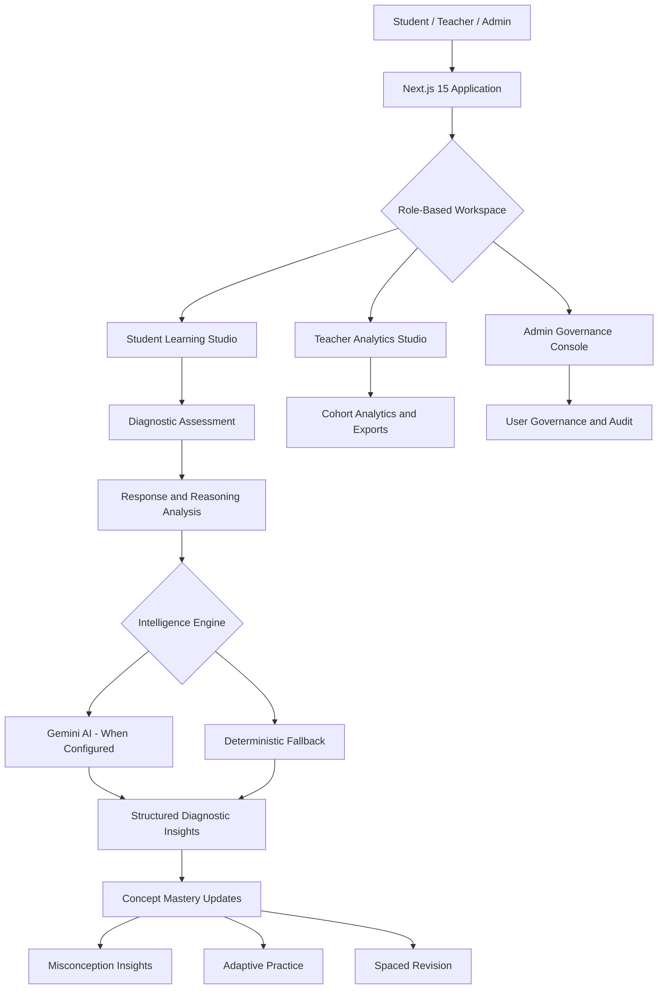

<p align="center">
  
</p>

<div align="center">

# MEDHA
### Adaptive AI Learning Intelligence Platform

**Know what you know. Fix what you don't.**

An evidence-driven learning intelligence platform that aims to identify conceptual gaps, diagnose misconceptions and guide students toward deeper understanding.

[**LIVE DEMO**](https://medha-vofd.onrender.com/) · [**SOURCE CODE**](https://github.com/nikhilkunte645-maker/MEDHA)

</div>

<p align="center">
  
  
  
  
  
</p>

---

## 1. Experience MEDHA

| Resource | Link |
|---|---|
| Live application | https://medha-vofd.onrender.com/ |
| GitHub repository | https://github.com/nikhilkunte645-maker/MEDHA |
| Application domain | AI-powered adaptive education |
| Academic demonstration scope | Class 10 Physics — Electricity |
| Learning model | Nine-concept prerequisite topology |

**Start with the live demo:** explore the available workspaces and the student learning experience. Demo account access should be provided separately by the project team; passwords are intentionally not published in this repository.

---

## 2. The Problem: A Correct Answer Does Not Always Mean Understanding

Most conventional digital learning systems emphasize scores, completion rates and right-or-wrong answers.

But these signals do not necessarily explain what a student understands.

A student may select the correct option by guessing. Another may arrive at an incorrect answer because of a deeper misconception rather than a simple calculation error.

These situations require different educational interventions.

The core problem MEDHA addresses is:

**How can a learning platform move beyond evaluating answers and begin understanding the learner's conceptual gaps?**

### The gaps in conventional learning

- **Guessing versus understanding:** A correct answer alone may not establish genuine conceptual mastery.
- **Surface-level feedback:** Marking an answer wrong does not explain the underlying misconception.
- **Disconnected concepts:** Weakness in a prerequisite concept can affect performance in later topics.
- **Limited personalization:** Identical practice for every student does not address individual learning needs.
- **Insufficient teacher visibility:** Scores alone may not reveal recurring conceptual difficulties across a class.

---

## 3. The MEDHA Approach

MEDHA is designed around a continuous learning-intelligence cycle:

1. Establish a student's conceptual baseline.
2. Collect assessment responses and reasoning evidence.
3. Analyze the student's understanding.
4. Map performance to individual curriculum concepts.
5. Identify possible misconceptions.
6. Update concept-level mastery estimates.
7. Guide targeted practice and revision.
8. Use subsequent learning evidence to refine the learner profile.

The intended shift is from:

**Score tracking → Understanding analysis → Targeted intervention**

MEDHA is not positioned as another generic question-answer chatbot. Its central product idea is a structured representation of what a learner understands, where that understanding breaks down and what should happen next.

---

## 4. Core Innovation: A Nine-Concept Learning Topology

The current demonstration focuses on Class 10 Physics — Electricity.

Rather than treating the chapter as one undifferentiated unit, MEDHA models nine concepts and their prerequisite relationships as a directed acyclic graph (DAG).

| ID | Concept | Learning focus |
|---|---|---|
| C01 | Electric Charge and Current | Charge, current and drift of charge carriers |
| C02 | Potential Difference | Work done per unit charge |
| C03 | Circuit Diagrams and Symbols | Circuit representation and components |
| C04 | Ohm's Law | Relationship between voltage, current and resistance |
| C05 | Resistivity | Material properties and resistance |
| C06 | Resistors in Series | Equivalent resistance and current |
| C07 | Resistors in Parallel | Branches, equivalent resistance and voltage |
| C08 | Heating Effect of Current | Joule's law and electrical heating |
| C09 | Electric Power | Power, energy and consumption |

### Why the topology matters

Concepts are not independent.

For example, a student struggling with current and potential difference may also struggle with Ohm's law and resistor networks.

A prerequisite-aware model can make those dependencies visible and help direct attention toward foundational gaps instead of repeatedly practicing only the final topic.

---

## 5. Product Features

### Student Learning Studio

- **Cognitive Overview:** A consolidated view of learning progress and actionable insights.
- **Diagnostic Assessment:** An 11-question baseline assessment for the current Electricity demonstration.
- **Concept Topology:** A nine-concept curriculum map with prerequisite relationships.
- **Concept Mastery:** Evidence-oriented concept-level progress tracking.
- **Misconception Studio:** A dedicated experience for examining potential conceptual misunderstandings.
- **Adaptive Practice:** Targeted practice based on identified learning needs.
- **Spaced Revision:** Revision scheduling using the implemented learning workflow.
- **Learning Workspace:** A central environment for student learning activities.

### Teacher Analytics Studio

- Class and cohort-level learning visibility.
- Misconception frequency analysis.
- Individual student drill-down.
- Student learning evidence and mastery insights.
- CSV and JSON gradebook exports.

### Admin Governance Console

- User provisioning.
- Cohort and teacher mapping.
- Session management controls.
- Administrative audit visibility.

These portals separate the needs of learners, educators and administrators rather than forcing every role into one generic dashboard.

---

## 6. AI and Cognitive Intelligence

MEDHA uses a dual-mode reasoning architecture.

### Online AI mode

The application integrates Google's Generative AI SDK for supported reasoning-analysis workflows.

When configured with a valid Gemini API key, the AI pipeline can be used to analyze submitted reasoning and produce structured diagnostic insights.

### Deterministic fallback mode

AI availability should not be a single point of failure.

The project also includes deterministic heuristic fallback logic for supported diagnostic workflows when the external AI service is unavailable or not configured.

The distinction between live AI processing and fallback processing is important: a deterministic response should never be presented as though it was generated by a live model.

### Learning intelligence

The current project design includes:

- Concept-level mastery updates.
- Bayesian-style evidence calibration and inertia damping.
- Misconception classification.
- Prerequisite-aware learning insights.
- Spaced revision intervals of 1, 3 and 7 days.

These mechanisms are intended to make learning progress more meaningful than a single assessment score.

---

## 7. System Architecture



### Technology stack

| Layer | Technology |
|---|---|
| Framework | Next.js 15 |
| Frontend | React 19 |
| Language | TypeScript 5.7 |
| Styling | Tailwind CSS |
| Motion | Framer Motion |
| Icons | Lucide React |
| AI SDK | Google Generative AI |
| Authentication support | bcryptjs and server-side session workflows |
| Runtime | Node.js |
| Deployment | Render |

---

## 8. Security and Responsible Design

Learning platforms handle student-related information, so security and role separation matter.

The project includes security-oriented design elements such as:

- Role-based access to student, teacher and administrator workspaces.
- Server-side authentication workflows.
- Password hashing support through bcryptjs.
- Session controls.
- Teacher cohort-scoping workflows.
- Administrative audit visibility.
- Separation of local runtime data from source-controlled application code.

These are implementation claims, not a substitute for an independent production security certification. Any public deployment should undergo a fresh authorization, privacy and data-persistence review.

**Security note:** Never commit `.env.local`, API keys, session secrets, real student records or passwords. Demo credentials are deliberately excluded from this README.

---

## 9. Run MEDHA Locally

### Prerequisites

- Node.js 20 or later.
- npm.
- Git.

### Clone

```bash
git clone https://github.com/nikhilkunte645-maker/MEDHA.git
cd MEDHA
```

### Install dependencies

```bash
npm install
```

### Configure environment

```powershell
Copy-Item .env.example .env.local
```

Configure the required environment variables locally. For Gemini-enabled functionality, supply the appropriate API key through the server-side environment configuration.

Do not commit `.env.local`.

### Start development

```bash
npm run dev
```

Open:

http://localhost:3000

### Production build

```bash
npm run build
```

### TypeScript verification

```bash
npx tsc --noEmit
```

---

## 10. Deployment

The current public demonstration is hosted on Render.

**Live application:** https://medha-vofd.onrender.com/

The deployed environment requires appropriate server-side environment configuration for integrations that depend on secrets or external services.

### Persistence consideration

The current project uses a server-side JSON persistence implementation. This is appropriate to describe as a prototype architecture, but it should not be assumed to provide durable multi-instance production storage.

For larger deployments, a managed database such as PostgreSQL would be a more suitable next step, with explicit backup, migration and access-control policies.

---

## 11. What Makes MEDHA Different?

| Conventional learning platform | MEDHA's approach |
|---|---|
| Primarily tracks marks | Tracks concept-level evidence |
| Treats answers as isolated events | Connects concepts through prerequisites |
| Reports right or wrong | Aims to analyze reasoning and misconceptions |
| Gives generic practice | Supports targeted practice |
| Shows basic student progress | Provides student and teacher learning insights |
| Depends on one AI path | Includes a deterministic fallback path for supported workflows |

The differentiation is not simply the use of an LLM. It is the combination of structured curriculum relationships, reasoning analysis, mastery estimation, remediation and role-specific learning intelligence.

---

## 12. Current Scope and Limitations

MEDHA is a hackathon prototype with a focused academic demonstration scope.

Current scope:

- Class 10 Physics — Electricity.
- Nine modeled curriculum concepts.
- Student, teacher and admin workspaces.
- AI-assisted reasoning analysis where configured.
- Deterministic fallback for supported workflows.
- Concept mastery and revision mechanisms.

Important limitations:

- The current academic demonstration is not a complete multi-subject curriculum.
- AI-generated diagnostic insights require evaluation against expert-reviewed student reasoning.
- Heuristic fallback cannot replace unrestricted human pedagogical judgment.
- JSON persistence requires architectural improvement before production-scale deployment.
- A live deployment does not by itself establish production-grade security, reliability or learning outcomes.

---

## 13. Future Roadmap

Potential next development stages:

1. Expand the curriculum beyond Class 10 Electricity.
2. Introduce expert-reviewed diagnostic datasets.
3. Improve misconception detection and reasoning evaluation.
4. Add richer longitudinal mastery analytics.
5. Improve teacher intervention recommendations.
6. Introduce scalable relational database persistence.
7. Add more comprehensive privacy and security testing.
8. Evaluate learning outcomes through controlled student studies.

---

## 14. Project Information

| Field | Information |
|---|---|
| Project name | MEDHA |
| Full name | Adaptive AI Learning Intelligence Platform |
| Domain | Artificial Intelligence / EdTech |
| Project type | Hackathon prototype |
| Academic scope | Class 10 Physics — Electricity |
| Repository | GitHub |
| Live demo | Render |

### Repository

https://github.com/nikhilkunte645-maker/MEDHA

### Live Demo

https://medha-vofd.onrender.com/

---

<div align="center">

# MEDHA

### Know what you know. Fix what you don't.

**Moving learning beyond scores — toward understanding.**

[Open Live Demo](https://medha-vofd.onrender.com/) · [Explore Source Code](https://github.com/nikhilkunte645-maker/MEDHA)

</div>
