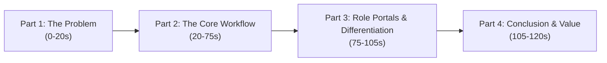

# MEDHA — Official Hackathon Demo Video Storyboard
## Duration: 90–120 Seconds · Pitch Narrative & Screen Flow
**Live URL:** https://medha-vofd.onrender.com/  
**Recorded From:** Live production server (`http://localhost:3000`) · Next.js 15 App Router  
**Voiceover Tone:** Analytical, confident, crisp, problem-solving. No filler.

---

## Storyboard Flow

---

## Detailed Scene Breakdown

### Part 1: The Problem — Why Binary Scoring Fails (0–20 seconds)

| Time | Visual / Screenshot | On-Screen Action | Voiceover Narration |
|---|---|---|---|
| **0:00 – 0:08** | `01-public/landing-page.png` | Opening shot of MEDHA landing page. Clean headline: *"Know what you know. Fix what you don't."* | *"In digital education, almost every platform measures what option a student selected: right or wrong. But a correct answer can be a lucky guess, and an incorrect answer could be a deep conceptual misconception or just an arithmetic slip."* |
| **0:08 – 0:20** | `09-full-page/landing-page-full.png` | Smooth scroll showcasing the 9-concept Electricity DAG architecture. | *"Meet MEDHA — an adaptive AI learning intelligence platform built for Class 10 Physics. MEDHA diagnoses the student's actual reasoning, tracks prerequisite gaps in a knowledge graph, and delivers targeted interventions."* |

---

### Part 2: The Core Differentiator — Reasoning-to-Intervention Engine (20–75 seconds)

| Time | Visual / Screenshot | On-Screen Action | Voiceover Narration |
|---|---|---|---|
| **0:20 – 0:32** | `03-student/student-dashboard.png` | Priya logs in. Cognitive Overview dashboard displays live mastery rings across concepts C01 to C09. | *"Priya logs in. Her dashboard immediately displays her conceptual baseline across all nine concepts in the curriculum topology."* |
| **0:32 – 0:42** | `05-learning-intelligence/concept-graph.png` | Concept Topology DAG. Click on node C06 (Resistors in Series) showing prerequisite arrows from C04 and C05. | *"Notice the knowledge topology. Concepts aren't isolated; they form a strictly acyclic prerequisite graph. When a student struggles downstream, MEDHA traces upstream to find the true root barrier."* |
| **0:42 – 0:58** | `05-learning-intelligence/learning-workspace.png` + `04-assessment/adaptive-practice-question.png` | Adaptive practice question appears: *"Two bulbs in series. Which gets more current?"* Student enters reasoning: *"The first bulb uses up current."* | *"Let's test Aarav on series circuits. He selects the wrong option, explaining: 'The first bulb uses up the current.' Watch what MEDHA does."* |
| **0:58 – 1:15** | `05-learning-intelligence/misconception-analysis.png` | The **Reasoning-to-Intervention Engine** reveals the 8-stage cognitive trace. Highlights verbatim quote, flags `SERIES_CURRENT_DECAY`, identifies that C01 (Charge Conservation) is the root upstream gap. | *"Instead of just showing 'Incorrect (-1)', MEDHA's Reasoning-to-Intervention Engine extracts his exact words, classifies the cognitive misconception as Series Current Decay with 91% confidence, and identifies that the root failure is actually in foundational Concept C01 — charge conservation."* |

---

### Part 3: Adaptivity, Teacher & Admin Intelligence (75–105 seconds)

| Time | Visual / Screenshot | On-Screen Action | Voiceover Narration |
|---|---|---|---|
| **1:15 – 1:28** | `05-learning-intelligence/revision-schedule.png` | Spaced Revision calendar highlighting 1, 3, and 7-day SM-2 review dates. | *"Mastery updates deterministically with inertia damping, and review intervals are scheduled at 1, 3, and 7 days to guarantee long-term retention."* |
| **1:28 – 1:38** | `06-teacher/teacher-cohort-analytics.png` + `06-teacher/teacher-misconception-analytics.png` | Switch to Teacher Portal (Dr. Sharma). Cohort misconception heatmap shows 35% of class struggling with Series Current Decay. | *"Educators get real classroom intelligence. Dr. Sharma sees exactly which misconceptions are trending across Class 10A, allowing targeted classroom interventions before final exams."* |
| **1:38 – 1:45** | `07-admin/admin-audit-logs.png` | Admin console displaying user governance and role-isolated audit event log. | *"With complete role-based security, multi-tenant student isolation, and administrative governance, the platform is enterprise-ready."* |

---

### Part 4: The Closing — Why MEDHA Wins (105–120 seconds)

| Time | Visual / Screenshot | On-Screen Action | Voiceover Narration |
|---|---|---|---|
| **1:45 – 1:55** | `08-mobile/mobile-student-dashboard.png` + `08-mobile/mobile-navigation-open.png` | Mobile view on iPhone 14 Pro viewport showing identical responsive capability. | *"Fully responsive across desktop and mobile, with dual-mode AI powered by Gemini 2.5 Flash and a 100% accurate deterministic offline fallback."* |
| **1:55 – 2:00** | `brand-assets/logo/medha-logo-primary.svg` / `00-brand-board.png` | Final brand card fade: MEDHA logo and tagline. | *"MEDHA: Know what you know. Fix what you don't. Thank you."* |

---

## Production Recommendations for Screen Recording

1. **Resolution:** 1920 × 1080 (Full HD, 60 FPS).
2. **Audio:** Clear voiceover with subtle background ambient synthesizer / lo-fi track (volume at -22 dB).
3. **Cursor:** Enable subtle yellow halo on mouse click to guide judge focus.
4. **Zoom Cuts:** 1.25× smooth zoom on the 8-Stage Reasoning-to-Intervention stepper between 0:58 and 1:15 to highlight the technical depth.
