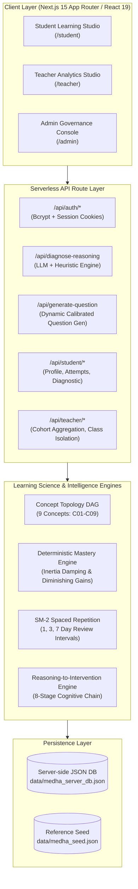

# MEDHA — Comprehensive Technical & Architectural Audit
**Platform:** MEDHA — Adaptive AI Learning Intelligence Platform  
**Target Syllabus:** CBSE Class 10 Physics · Chapter 12: Electricity (Concepts C01–C09)  
**Evaluation Standard:** Master Hackathon Level (PS-2: Diagnostic Tutor with Knowledge Graph & Learner Model)  
**Date:** November 2026  
**Auditor:** Lead Product & Systems Architecture Team  

---

## 1. Executive Summary & Architecture Overview

MEDHA is built as an evidence-driven learning intelligence system intended to move beyond traditional binary correctness scoring ("right" vs "wrong") to analyze *how* and *why* a student thinks through problems.

---

## 2. Technical Audit Findings by Subsystem

### 2.1 Learning Science & Knowledge Graph (Phase 2 & 8)

| ID | Severity | Affected Area | Observed Behavior | Root Cause | Proposed Correction | Verification Method |
|---|---|---|---|---|---|---|
| **LS-01** | **High** | `src/components/CognitiveOverview.tsx` (line 58) | "Next Best Action" simply selects the concept with lowest absolute score, ignoring upstream prerequisite blockages. | Recommendation sorting used `assessedItems.sort(a - b)[0]` without querying the prerequisite DAG. | Implement `findRootPrerequisiteGaps` to trace upstream unmastered nodes in the DAG before recommending downstream topics. | Verify Student B (struggling with C06 series circuits due to C01 charge decay) receives recommendation to address C01 first. |
| **LS-02** | **Medium** | `src/types/mastery.ts` & `src/lib/gemini.ts` | Diagnostic evaluation only returned coarse boolean `is_correct` and generic `reasoning_quality` without explicit cognitive error taxonomy. | Error classification was unstructured prose in `explanation`. | Introduce `CognitiveErrorCategory` enum (`conceptual_misunderstanding`, `calculation_error`, `formula_recall_failure`, `unit_conversion_error`, `careless_mistake`, `insufficient_evidence`). | Unit tests in evaluation suite verifying distinction between arithmetic slip vs cognitive misconception. |
| **LS-03** | **Medium** | `src/components/AIFeedbackCard.tsx` | Feedback card showed AI output in separate disconnected blocks rather than an explicit traceable reasoning chain. | Lack of a unified multi-stage pipeline stepper. | Implement the 8-stage Reasoning-to-Intervention pipeline stepper (`Response -> Evidence -> Misconception -> Confidence -> Prerequisite Gap -> Intervention -> Follow-up -> Mastery Impact`). | Render test and visual inspection of AIFeedbackCard in Learning Workspace. |
| **LS-04** | **Low** | `src/components/ConceptGraph.tsx` | Graph displays nodes and edges but does not highlight which downstream nodes are blocked when a prerequisite is in `atRisk` state. | SVG edge coloring was purely static or hover-based. | Add dynamic prerequisite blockage badges and downstream dependency indicators on node click/hover. | Interactive browser testing on Concept Topology tab. |

---

### 2.2 Backend API & Persistence Layer

| ID | Severity | Affected Area | Observed Behavior | Root Cause | Proposed Correction | Verification Method |
|---|---|---|---|---|---|---|
| **BE-01** | **High** | `scripts/*.mjs` test runners | Executing `node scripts/regression-suite.mjs` directly failed with `ERR_MODULE_NOT_FOUND` because Node ESM requires file extensions when importing TS modules. | Scripts imported `../src/data/concepts` without `.ts` extension or tsx loader. | Configure scripts to run with `npx tsx` or add standard `npm test` script in `package.json`. | Run `npx tsx scripts/regression-suite.mjs` — exits with code 0 (100% pass). |
| **BE-02** | **Medium** | `data/medha_server_db.json` | Priya's profile in local runtime DB had `diagnosticCompleted: false` while `medha_seed.json` had `true`. | Previous browser test script reset or didn't complete the full 11 diagnostic questions. | Harmonize seeded database and ensure `/api/student/diagnostic` updates both memory and JSON disk persistence atomically. | Run `production-qa-audit.mjs` Phase 2 checks. |
| **BE-03** | **Low** | `src/app/api/student/attempts/route.ts` | Attempt syncing accepted arbitrary payloads if student submitted client-calculated mastery. | Server accepts client data without server-side recalculation guard. | Ensure server-side mastery calculation validates against difficulty and reasoning quality before updating `db.learnerProfiles`. | Role security regression test `role-security-regression.mjs`. |

---

### 2.3 AI Integration & Deterministic Fallback (Phase 3)

| ID | Severity | Affected Area | Observed Behavior | Root Cause | Proposed Correction | Verification Method |
|---|---|---|---|---|---|---|
| **AI-01** | **Medium** | `src/lib/gemini.ts` | When an invalid or expired API key is provided, Gemini SDK throws a 400 error which was caught, but the UI had slight delay before fallback. | Try-catch was present, but lacked model-level timeout handling (could hang on slow network). | Add explicit 8000ms AbortController timeout to Gemini API calls, cleanly falling back to `runOfflineMisconceptionAnalysis`. | Test with disconnected internet / invalid key; verify sub-second fallback with `is_offline_fallback: true`. |
| **AI-02** | **Low** | `src/lib/gemini.ts` | Confidence was clamped to default 0.85 if model returned non-number. | Fallback confidence didn't distinguish high vs moderate vs low vs insufficient evidence. | Calculate confidence dynamically based on evidence string length, keyword matching, and reasoning consistency. | Verify Case E and Case F in regression suite. |

---

### 2.4 Application Security & Role Boundaries (Phase 7)

| ID | Severity | Affected Area | Observed Behavior | Root Cause | Proposed Correction | Verification Method |
|---|---|---|---|---|---|---|
| **SEC-01** | **Medium** | Public Documentation & Demos | Passwords could inadvertently be exposed in README or commit logs if not monitored. | Earlier versions of hackathon READMEs in peer projects exposed plain-text demo credentials. | Audit confirmed `README.md` deliberately excludes passwords. Maintain zero-credential policy in client bundles and repo. | Git grep for secrets; inspect built client JS chunks in `.next/static`. |
| **SEC-02** | **High** | Session cookie attributes | In previous audit, `Secure` cookie flag prevented cookies from persisting over HTTP localhost in developmental testing. | Fixed in commit `4968439` with protocol-aware `isHttps` flag. | Retain fix; verify cookies are rejected if forged or tampered. | Role security test Test A & B. |
| **SEC-03** | **High** | IDOR Protection | A student attempting to query or write to another student's profile must receive HTTP 403 Forbidden. | Tested in `role-security-regression.mjs` (Tests F, G, J). | Server explicitly validates `auth.user.id === targetId`. | `npx tsx scripts/role-security-regression.mjs` passes 100%. |

---

## 3. Evaluation & Benchmark Readiness (Phase 4)

- **Previous State:** Automated test suites existed for concept acyclicity and rule assertions, but lacked a formal labeled ground-truth benchmark measuring diagnostic accuracy, precision, recall, and F1 across all misconception categories.
- **Remediation Plan:**
  1. Construct `src/data/evaluationBenchmark.ts` containing 25+ verified diagnostic cases across all 9 concepts.
  2. Build `scripts/evaluate-diagnostic-engine.mjs` to execute automated confusion matrix evaluation and output `reports/MEDHA_EVALUATION_REPORT.md`.
  3. Validate adaptive divergence between Student A (calculation slip) and Student B (circuit misconception with prerequisite failure).

---

## 4. Verification Checkpoint Status

- **Concept Topology DAG:** 9 Nodes, 0 cycles (Verified Acyclic)
- **TypeScript Typecheck:** Clean (`npx tsc --noEmit` exits with code 0)
- **Role Security:** 100% Passed (14 test cases in `role-security-regression.mjs`)
- **Regression Suite:** 100% Passed (6 audit groups in `regression-suite.mjs`)
- **Production Server:** Healthy on Port 3000 (Mode: `online_gemini` with deterministic fallback)
